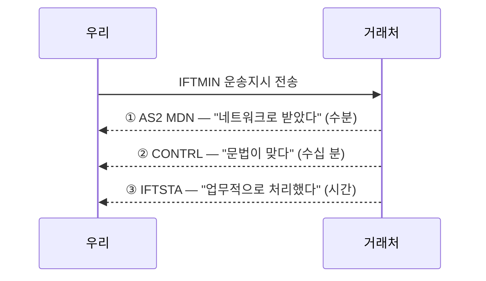
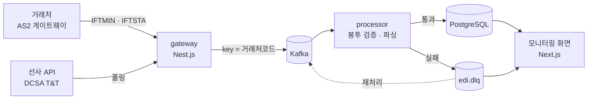

# edi-poc

해운 EDI/API 모니터링 시스템 PoC — **거래처 전문과 선사 API 이벤트를 메시지 브로커로 받아 검증하고, 어느 층에서 막혔는지 추적한다.**

> **구축 중 · 1/9 단계.** 현재는 로컬 인프라(Kafka + 토픽)까지 올라와 있다. 진행 상황은 아래 [로드맵](#로드맵) 참조.
> 모든 전문·거래처·화물 정보는 **합성 데이터**다. 실제 거래처 시스템에 연결하지 않는다.

`Kafka 4.0 (KRaft)` · `TypeScript` · `Nest.js` · `Next.js` · `PostgreSQL` · `Docker Compose`

---

## 왜 만드나

EDI 운영에서 사고가 나는 건 "파싱 실패"보다 **층 사이의 불일치**다. 전문을 보냈는데 응답이 안 오는 상황에서, 어느 층이 멈췄는지를 아는 것이 대응의 출발점이다.



| 증상 | 원인 |
|---|---|
| ①이 안 옴 | 네트워크 · 인증서 만료 · 상대 게이트웨이 다운 |
| ①은 왔는데 ②가 안 옴 | 상대 파서가 죽었다. 전문은 받았는데 못 읽는다 |
| ②는 OK인데 ③이 없음 | 문법은 맞는데 업무 시스템에서 막혔다 |
| ②가 거부 | 우리 전문이 잘못됐다 |

**층마다 SLA가 다르므로 알림 임계값도 따로 잡아야 한다.** 이 도구가 보는 것이 그것이다.

---

## 구조



### 토픽

| 토픽 | 파티션 | 보존 | |
|---|---|---|---|
| `edi.inbound` | 3 | 7일 | 수신 원문 (봉투 해체 전) |
| `edi.parsed` | 3 | 7일 | 파싱·검증 통과 |
| `edi.dlq` | **1** | **30일** | 실패 — 재처리 대상 |
| `edi.status` | 3 | 7일 | 처리 상태 이벤트 |
| `as2.transmission` | 3 | 7일 | 전송 시도 |
| `as2.mdn` | 3 | 7일 | 수신확인 |

---

## 설계 결정

### 왜 Kafka인가

세 가지다. 거래처가 한꺼번에 전문을 밀어 넣어도 컨슈머가 자기 속도로 처리할 수 있고, 실패한 전문을 오프셋 되감기나 DLQ로 다시 처리할 수 있고, **소비자가 늘어도 보내는 쪽을 안 고쳐도 된다.**

마지막이 가장 크다. HTTP로 받으면 수신 서버가 모니터링·아카이빙·알림에 각각 전달해야 하는데, 토픽에 쌓아두면 셋이 같은 스트림을 각자 읽는다.

큐(RabbitMQ·SQS)와의 차이도 여기서 나온다. 큐는 꺼내면 사라지지만 Kafka는 읽어도 남는다. **파서를 고친 뒤 어제 실패한 전문을 그대로 다시 흘려보내** 검증하려면 메시지가 남아 있어야 한다.

### 파티션 키 = 거래처 코드

Kafka는 **파티션 안에서만** 순서를 보장한다. 같은 거래처 전문은 같은 파티션에 들어가 보낸 순서대로 처리되고, 다른 거래처는 병렬로 흐른다. 컨테이너 상태 전문이 뒤집히면 안 되지만 전체 직렬화는 처리량을 버리므로, 순서가 필요한 단위를 키로 잡았다.

DLQ만 파티션 1인 것은 처리량이 아니라 **사람이 시간순으로 훑는 물건**이기 때문이다.

### AS2는 구현하지 않는다

인증서 관리·S/MIME·MIC 계산은 모니터링 툴의 본질과 무관하고, 실무에서도 AS2 게이트웨이는 상용 제품을 쓰고 모니터링은 따로 만든다. 이 도구는 게이트웨이가 내보내는 **이벤트를 소비하는 쪽**으로 모델링한다.

```ts
as2.transmission  { messageId, partner, bytes, signed, encrypted, sentAt }
as2.mdn           { originalMessageId, disposition, micMatched, receivedAt }
```

### EDI와 API를 함께 본다

해운업계는 EDI에서 API로 넘어가는 중이다. DCSA Track & Trace API를 도입한 선사가 늘고 있지만, 작은 포워더·터미널은 여전히 EDIFACT를 쓴다. **당분간 공존하므로 모니터링 툴이 둘 다 봐야 한다.**

같은 화물을 양쪽으로 받아 대조하면 전환기 특유의 문제가 드러난다 — API로는 양하 완료가 왔는데 EDI IFTSTA가 SLA를 넘겨 안 오는 경우처럼.

---

## 실행

### 요구사항

Docker Desktop (Linux 컨테이너 모드) · Node 20+

### 로컬 인프라 띄우기

```bash
docker compose up -d
docker compose logs topics-init    # 토픽 생성 결과
```

| | |
|---|---|
| Kafka UI | http://localhost:8080 |
| 브로커 (호스트에서) | `localhost:9092` |

```bash
docker compose down       # 중지 — 토픽은 볼륨에 남는다
docker compose down -v    # 중지 + 데이터 삭제
```

### 메시지를 직접 넣어보기

```bash
docker exec -it edi-kafka /opt/kafka/bin/kafka-console-producer.sh \
  --bootstrap-server localhost:9092 --topic edi.inbound

docker exec -it edi-kafka /opt/kafka/bin/kafka-console-consumer.sh \
  --bootstrap-server localhost:9092 --topic edi.inbound --from-beginning
```

---

## 로컬 셋업 메모

### 리스너를 셋으로 나눈 이유

Kafka 로컬 셋업에서 제일 자주 막히는 지점이라 적어둔다.

```
HOST        localhost:9092   호스트에서 도는 앱(Nest.js · 테스트)
DOCKER      kafka:19092      같은 compose 망의 컨테이너(Kafka UI)
CONTROLLER  kafka:9093       KRaft 내부
```

클라이언트는 먼저 아무 브로커에나 붙어 파티션 메타데이터를 받고, 거기 적힌 `advertised.listeners` 주소로 **다시** 접속한다. 그래서 이 값이 틀리면 첫 연결은 되는데 그다음부터 안 되는, 원인 찾기 어려운 증상이 난다. `advertised`를 `localhost` 하나로만 두면 Kafka UI 컨테이너가 자기 자신에게 접속하려다 실패한다.

### 복제 팩터를 명시한 이유

Kafka는 컨슈머 그룹의 오프셋을 `__consumer_offsets` 내부 토픽에 저장하는데, 기본 복제 수가 3이라 브로커 1대로는 만들 수 없다. **브로커 기동은 멀쩡히 되고 컨슈머가 붙는 순간 실패**해서 원인을 찾기가 성가시다.

### 자동 토픽 생성을 끈 이유

켜두면 `edi.inbound`를 `edi.inbount`로 오타 내도 조용히 새 토픽이 생긴다. 컨슈머는 빈 토픽을 보며 "메시지가 안 온다"고 하게 된다. 대신 `topics-init` 컨테이너가 명시적으로 만들어 **파티션 수와 보존 기간이 파일에 남는다.**

---

## 로드맵

| | 단계 | 상태 |
|---|---|---|
| 1 | 로컬 인프라 — Kafka(KRaft) · Kafka UI · 토픽 | ✅ |
| 2 | 합성 EDIFACT 전문 — IFTMIN · CONTRL · IFTSTA + 깨뜨린 전문 | |
| 3 | `packages/edifact` 파서 + 봉투 검증 + 단위 테스트 | |
| 4 | 프로듀서 → 컨슈머 한 바퀴 (+ PostgreSQL) | |
| 5 | DLQ + 재처리 | |
| 6 | 3단 수신확인 매칭 · SLA 추적 | |
| 7 | 모니터링 화면 (Next.js) | |
| 8 | EDI ↔ 선사 API 대조 | |
| 9 | 문서 · 아키텍처 다이어그램 | |

---

## 범위

| 구현 | 제외 |
|---|---|
| EDIFACT 봉투 검증 · 메시지 파싱 | AS2 프로토콜 구현 (인증서 · S/MIME · MIC) |
| 3단 수신확인 매칭과 SLA 추적 | 실제 거래처 연동 |
| DLQ · 재처리 | VAN · OFTP2 |
| EDI ↔ 선사 API 대조 | 다중 브로커 클러스터 운영 |

**모든 데이터는 합성 데이터다.** 실제 거래처명·컨테이너 번호·전문 내용을 사용하지 않는다.
